# TransitSpotter

A private personal bus-spotting database and photography archive. Catalog the buses you photograph, record each sighting, attach originals, explore where you have been spotting, and read your own coverage statistics — all behind Supabase authentication and Row Level Security.

TransitSpotter is deliberately **not** a public gallery or a generic admin dashboard. Every private page and data route requires a session; the only unauthenticated endpoints are sign-in, password recovery, auth callbacks and a configuration health check. Every row and every image belongs to exactly one account.

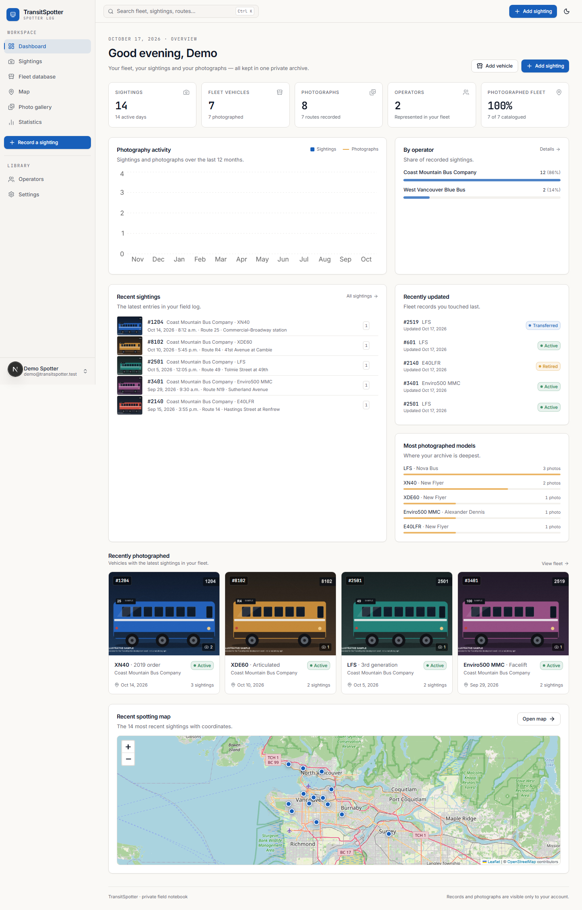

---

## Contents

- [What is implemented](#what-is-implemented)
- [Stack](#stack)
- [Repository layout](#repository-layout)
- [Quick start](#quick-start)
- [Supabase project setup](#supabase-project-setup)
- [Database migrations](#database-migrations)
- [Authentication configuration](#authentication-configuration)
- [Development seed data](#development-seed-data)
- [Commands](#commands)
- [Testing and verification](#testing-and-verification)
- [Data model and deletion policy](#data-model-and-deletion-policy)
- [Security and privacy](#security-and-privacy)
- [Exports](#exports)
- [Deployment](#deployment)
- [Known limitations / external configuration](#known-limitations--external-configuration)
- [Design and interface notes](#design-and-interface-notes)
- [Attributions](#attributions)

---

## What is implemented

**Foundation**
- Next.js App Router application, strict TypeScript, Tailwind CSS v4 design tokens, hand-built shadcn/ui-style components on Radix primitives and Lucide icons.
- Light/dark themes with a toggle, cookie-based server rendering and a saved account preference.
- Supabase SSR authentication, protected routes in `src/proxy.ts`, server-side session checks, sign-out, password recovery, and email confirmation callbacks.
- Fully typed database layer with hand-written Supabase table/view/function types.

**Fleet database**
- Operators CRUD with abbreviation, region, ownership and notes.
- Vehicles with optional operator, fleet number, manufacturer, model, generation, category, powertrain, length, model year, in-service year, status, verification date, notes and cover photograph.
- Free-text category/powertrain/manufacturer fields with suggested values — nothing is limited to one agency or numbering scheme.
- Table and photographic grid views, search, six filters, eight sort orders, pagination and filter reset.
- Vehicle detail page with large cover image, specs, routes, all photographs, Sighting chronology, status history, notes, edit, delete and "record sighting".
- Manual status timeline recorded atomically by a Postgres function (`record_vehicle_status`), with date and notes. Status is never presented as automatically synchronised.

**Sightings**
- One-form sighting workflow with inline vehicle creation (the form state survives), current-time default, optional route/direction/location/coordinates, camera metadata, weather, notes and multiple photos.
- Map-click location picker with manual latitude/longitude editing and browser geolocation (only explicit coordinates are stored).
- List and gallery views, search across fleet/operator/route/location/notes, date range, operator/model/category/route filters, four sort orders, pagination and multi-select bulk deletion.
- Sighting detail page with large photograph, full metadata, vehicle summary, location map and the photograph manager.
- Editing pre-fills every saved value; photographs are managed separately so captions, covers and order stay consistent.

**Photography archive**
- Direct-to-Supabase Storage uploads with per-file progress, validation, retry, abort and server-side verification before the database row is created.
- Multiple photos per sighting, private signed URLs, object-fit layout without stretching, responsive thumbnails and a keyboard-navigable lightbox.
- Captions and alt text editing, cover selection per sighting, vehicle cover selection, photograph ordering, individual deletion, and original-file downloads.
- Gallery with search, operator/manufacturer/model/route/location filters, date range, three densities, pagination and empty/loading/fallback states.

**Map**
- Leaflet + OpenStreetMap with attribution, markers, popups (vehicle, fleet number, date, route, thumbnail, links), automatic fit-to-bounds, zoom/pan and operator/model/route/date filters.
- Sighting coordinates remain optional; unlocated records stay in the list, gallery and exports and are counted in the map footer.

**Statistics**
- All calculations use real saved records, filtered by date range, operator and category.
- Sightings over time, photography activity, operator/route/model distribution, most-spotted vehicles, unique photographed vehicles, catalogued vs photographed coverage and fleet distributions.
- Data rows link to the corresponding filtered sightings or fleet records.

**Data management**
- Vehicles CSV, sightings CSV, structured JSON and a streamed ZIP of original photographs with a manifest.
- Preferences for theme, date style, 12/24-hour time, units, default list/gallery views, gallery density and default map centre/zoom.
- Account display name, read-only email, sign-out, and an application/privacy information panel.

---

## Stack

| Concern | Choice | Version |
| --- | --- | --- |
| Framework | Next.js App Router (Turbopack builds) | 16.4.2 |
| UI runtime | React | 19.3.1 |
| Language | TypeScript, strict | 5.9.3 |
| Styling | Tailwind CSS v4 | 4.3.3 |
| Components | Radix UI primitives, Lucide icons | current stable |
| Database / Auth / Storage | Supabase (PostgreSQL 17.11) | `@supabase/supabase-js` 2.118.0, `@supabase/ssr` 0.12.7 |
| Maps | Leaflet + React Leaflet + OpenStreetMap tiles | 1.9.4 / 5.0.0 |
| Charts | Recharts | 3.10.1 |
| Forms | React Hook Form + server-side Zod validation | 7.90.0 / 4.6.7 |
| Notifications | Sonner | 2.0.8 |
| CSV / ZIP | PapaParse / Archiver | 5.7.0 / 8.0.0 |
| Tests | Vitest | 5.0.5 |

No Redux, no paid map or image service, no service-role key in application code.

---

## Repository layout

```
src/
  app/
    (app)/                 authenticated shell: dashboard, sightings, fleet,
                           map, gallery, stats, operators, settings
    api/                   search, photo download, CSV/JSON/ZIP exports, health
    auth/                  PKCE callback and token-hash confirmation routes
    login/                 sign-in / create account
    forgot-password/
    reset-password/
    layout.tsx             fonts, theme provider, tooltip/toaster, time zone sync
    globals.css            design tokens and Leaflet/Recharts polish
    not-found.tsx, error.tsx
  components/
    auth/ charts/ common/ dashboard/ forms/ gallery/ layout/ map/
    operators/ photos/ settings/ sightings/ stats/ ui/ vehicles/
  lib/
    actions/               server actions (auth, operators, vehicles,
                           sightings, photos, preferences)
    db/database.types.ts   typed Supabase schema
    queries/               server queries and read-model helpers
    validation/            Zod schemas shared with forms
    photos-server.ts       signed URL and download helpers
    storage-server.ts      storage cleanup helpers
    upload-client.ts       XHR upload with progress (direct to Storage)
    export-data.ts         export loaders and CSV row shaping
  proxy.ts                 session refresh + route protection (Next 16 proxy)
supabase/
  migrations/              five SQL migrations (schema, functions/views,
                           RLS, storage, gallery views)
scripts/
  apply-migrations.mjs     apply SQL via the Supabase Management API
  verify-rls.mjs           live two-user isolation test (22 checks)
  smoke-test.mjs           authenticated page/API smoke test
  seed.mjs                 development-only example records
  generate-seed-images.py  optional illustrative sample images (Pillow)
tests/                     Vitest unit tests
docs/screenshots/          screenshots from the browser walkthrough
```

---

## Quick start

Prerequisites: **Node.js 20.9+** (tested on 24.21), **pnpm** (tested on 11.28) or npm, and a Supabase project. Python 3 with Pillow is only needed for the optional sample images.

```bash
pnpm install
cp .env.example .env.local     # PowerShell: Copy-Item .env.example .env.local
# fill in the Supabase values, then apply migrations (below)
pnpm dev
```

Open <http://localhost:3000>. The app starts on the sign-in screen; create an account or use the seeded development account.

> **Environment file.** `.env.local` is gitignored. Only `NEXT_PUBLIC_*` values reach the browser. The publishable/anon key is safe to expose because RLS enforces access; the service-role key is only used by the optional seed script and is never imported by application code.

---

## Supabase project setup

1. Create a project at <https://supabase.com/dashboard>.
2. In **Project Settings → API**, copy:
   - Project URL → `NEXT_PUBLIC_SUPABASE_URL`
   - Publishable key (or legacy anon key) → `NEXT_PUBLIC_SUPABASE_ANON_KEY`
3. Set `NEXT_PUBLIC_SITE_URL` to the origin you use (for example `http://localhost:3000`).
4. Apply the migrations (next section).
5. Confirm the storage bucket exists: **Storage → photos** should be **private**, with a 15 MB file limit and allowed MIME types `image/jpeg`, `image/png`, `image/webp`. The migration creates it and its policies.
6. In **Authentication → URL Configuration**:
   - **Site URL:** `http://localhost:3000` for local development.
   - **Redirect URLs:** add `http://localhost:3000/**`, and your production origin such as `https://your-app.vercel.app/**`.
   - If you keep email confirmation enabled, use the default confirmation URL; the app exchanges the PKCE `code` at `/auth/callback`. Token-hash templates are also supported at `/auth/confirm`.
7. Email delivery uses Supabase's built-in SMTP for development. Configure custom SMTP before relying on confirmation or password-reset emails in production.
8. For local-only experimentation you may disable "Confirm email" in **Authentication → Providers → Email**, but the application supports the confirmed flow and it is recommended.

### Required environment variables

```dotenv
NEXT_PUBLIC_SUPABASE_URL=https://your-project.supabase.co
NEXT_PUBLIC_SUPABASE_ANON_KEY=your-publishable-or-anon-key
SUPABASE_SERVICE_ROLE_KEY=            # scripts only; optional
NEXT_PUBLIC_SITE_URL=http://localhost:3000
NEXT_PUBLIC_SUPABASE_PHOTO_BUCKET=photos
NEXT_PUBLIC_MAX_UPLOAD_MB=15
```

The optional `DEMO_*`, `SMOKE_*` and `TEST_USER_*` values are development/verification only and are documented in `.env.example`.

---

## Database migrations

The SQL lives in `supabase/migrations/` and is safe to run in order:

1. `20261018090000_initial_schema.sql` — tables, constraints, partial unique indexes, trigram search indexes.
2. `20261018090100_functions_views.sql` — `updated_at` triggers, new-user bootstrap, cover-photo validation, `record_vehicle_status`, `vehicle_overview`, `sighting_overview`.
3. `20261018090200_rls.sql` — RLS enabled on every table, ownership policies, explicit grants (authenticated only; anonymous revoked).
4. `20261018090300_storage.sql` — private `photos` bucket, 15 MB limit, MIME allow-list, folder-ownership policies.
5. `20261018090400_gallery_views.sql` — `photo_overview` and `operator_overview` (`security_invoker = true`).

**Option A — Supabase SQL Editor.** Open each file in order and run it. This requires no CLI.

**Option B — Management API script.**

```bash
export SUPABASE_ACCESS_TOKEN=sbp_...     # personal access token, never committed
pnpm db:migrate
```

The script reads `supabase/migrations/*.sql` in order, executes each through `POST /v1/projects/{ref}/database/query`, then asks PostgREST to reload its schema cache. It uses `NEXT_PUBLIC_SUPABASE_URL` to derive the project ref. Re-running is safe: tables, indexes and policies use `if not exists` / `drop … if exists`.

The migrations create seven tables (`profiles`, `user_preferences`, `operators`, `vehicles`, `sightings`, `photos`, `vehicle_status_history`), four views and one RPC. No seed data is applied by migrations.

---

## Authentication configuration

- Sign-in and sign-up are handled by Supabase Auth through the browser client; the server uses cookie-based sessions from `@supabase/ssr`.
- `src/proxy.ts` refreshes the session on every request, redirects unauthenticated page requests to `/login?next=…`, and returns `401` for private API routes.
- The `(app)` layout independently calls `requireUser()`, and every table is protected by RLS. Frontend checks are never the only control.
- `/auth/callback` exchanges PKCE codes for email confirmation, magic links and password recovery. `/auth/confirm` verifies `token_hash` templates.
- Sign-out is a server action that clears the session cookies.
- Password recovery uses Supabase's reset email; the reset page requires the resulting recovery session.

---

## Development seed data

The repository contains **no production data**. `scripts/seed.mjs` creates a clearly-labelled example archive using the signed-in demo user and the public anon key, so every insert still passes through RLS.

```bash
# 1. Create a confirmed user in Supabase (Dashboard → Authentication → Users),
#    or let the script create it when SUPABASE_SERVICE_ROLE_KEY is set.
# 2. Configure a local password for that account:
#    DEMO_EMAIL / DEMO_PASSWORD in .env.local or the shell.

pnpm seed          # seeds 2 operators, 7 vehicles, 14 sightings and status history
pnpm seed -- --reset   # remove the demo archive and re-seed from scratch
```

Optional illustrative photos (generated illustrations, clearly marked, **not real bus photographs**):

```bash
python scripts/generate-seed-images.py seed-photos
# PowerShell:
$env:SEED_PHOTOS_DIR="seed-photos"; pnpm seed -- --reset
# macOS / Linux:
SEED_PHOTOS_DIR=seed-photos pnpm seed -- --reset
```

The seed stops rather than duplicating records if the account already has operators, unless `--reset` is supplied. It never touches other accounts.

---

## Commands

| Command | Purpose |
| --- | --- |
| `pnpm dev` | Start the development server |
| `pnpm build` | Production build (Turbopack) |
| `pnpm start` | Serve the production build |
| `pnpm lint` | ESLint (Next core-web-vitals + TypeScript, flat config) |
| `pnpm typecheck` | `tsc --noEmit` with strict mode |
| `pnpm test` | Vitest unit tests |
| `pnpm test:watch` | Vitest in watch mode |
| `pnpm check` | Typecheck + lint + unit tests |
| `pnpm db:migrate` | Apply migrations through the Supabase Management API |
| `pnpm seed` | Seed development examples (see above) |
| `pnpm smoke` | Authenticated smoke test against a running instance |
| `pnpm verify:rls` | Live two-user RLS/storage isolation test |

`pnpm smoke` signs in with `SMOKE_EMAIL`/`SMOKE_PASSWORD` (falling back to `DEMO_*`), builds the same session cookie the browser uses, then checks every private page, the search API, exports, photo download redirect and ZIP stream. `BASE_URL` overrides the default `http://127.0.0.1:3000`.

`pnpm verify:rls` needs two confirmed accounts (`TEST_USER_A_*`, `TEST_USER_B_*`) and creates temporary records, verifies isolation from the second account and anonymous callers, then cleans up. It also proves the storage bucket rejects cross-account reads/writes and unsupported MIME types.

---

## Testing and verification

### Automated checks run in this environment

| Check | Command | Result |
| --- | --- | --- |
| TypeScript | `pnpm typecheck` | pass, 0 errors |
| ESLint | `pnpm lint` | pass, 0 errors, 0 warnings |
| Unit tests | `pnpm test` | **24/24 pass** (`tests/format.test.ts`, `tests/validation.test.ts`) |
| Production build | `pnpm build` | pass, all routes compiled; app routes dynamic, `/icon.svg` static |
| RLS + storage isolation | `node scripts/verify-rls.mjs` | **22/22 pass** |
| Authenticated smoke test (dev server) | `node scripts/smoke-test.mjs` | **28/28 pass** |
| Authenticated smoke test (`next start`) | `BASE_URL=http://127.0.0.1:3001 node scripts/smoke-test.mjs` | **28/28 pass** |
| Browser walkthrough | Playwright (not shipped) | login, dashboard, themes, fleet views, vehicle/sighting detail, gallery, map, stats, settings, search, create sighting + photo upload + delete, inline vehicle creation, photo cover/caption/reorder/delete, sign-out, mobile navigation — **no uncaught page errors** |

Unit tests cover date/time zone formatting, month ranges, unit conversion, search-term sanitisation, query-string building, text utilities, optional-field coercion, coordinate pairing, status validation and photo type/size rules.

The browser walkthrough produced the screenshots in `docs/screenshots/` at 1440 px desktop and 390 px mobile. It also caught and fixed two real issues during development: a month-label time zone bug and mobile horizontal overflow from auto-sized grid tracks.

### Manual checks worth repeating

- Sign up with a fresh email, confirm it, sign in, and verify the profile/preferences rows were created automatically.
- Record a sighting without a photograph, then add one from the sighting page.
- Delete a sighting with photos and confirm the image objects disappear from **Storage → photos**.
- Sign in as a second account and confirm the first account's fleet, sightings and objects are invisible.
- Open the app at 390 px width and confirm there is no horizontal scrolling.

---

## Data model and deletion policy

| Table | Ownership | Notes |
| --- | --- | --- |
| `profiles` | `id = auth.uid()` | Display name and email; created by trigger |
| `user_preferences` | `user_id` | Theme, date/time, units, defaults, map centre |
| `operators` | `user_id` | Unique name per user (case-insensitive) |
| `vehicles` | `user_id` | Fleet number unique per user + operator when both exist; free-text specs; `cover_photo_id` validated to belong to the vehicle |
| `sightings` | `user_id` | Coordinates must be both null or both set; cascade from vehicle |
| `photos` | `user_id` | Metadata only; one cover per sighting (partial unique index); binary lives in Storage |
| `vehicle_status_history` | `user_id` | Append-only from the UI; linked to the vehicle |

**Deletion behaviour**

- **Photo:** the metadata row is deleted, then the storage object. If the object cannot be removed, the UI warns rather than pretending it was.
- **Sighting:** storage paths are collected and the image objects removed, then the sighting row is deleted, cascading its photo rows. If storage removal fails, the UI reports how many files could not be removed.
- **Vehicle:** image objects for all its sightings are removed first; if that fails the vehicle is not deleted. The vehicle row then cascades sightings → photos and status history. A photo used as a vehicle cover sets the cover to null via the foreign key.
- **Operator:** deleting an operator keeps its vehicles and sightings, setting `vehicles.operator_id` to null. The confirmation dialog states this.
- **Account deletion** is intentionally not exposed in the UI; remove the user from Supabase Authentication, which cascades all owned rows. Storage objects should be cleared first; the export ZIP exists for that purpose.

Storage paths are always `<user id>/<sighting id>/<uuid>.<ext>`, and the storage policy derives ownership from the first folder segment.

### Read models

`vehicle_overview`, `sighting_overview`, `photo_overview` and `operator_overview` are `security_invoker = true` views. RLS on the base tables therefore applies to every query and there is no path that bypasses ownership. `record_vehicle_status` is `security invoker` as well; it raises if the vehicle is not visible to the caller.

---

## Security and privacy

- RLS is enabled on every table. Policies are scoped `to authenticated` and compare `user_id` (or `profiles.id`) with `auth.uid()`. Inserts additionally verify that referenced vehicles/sightings/operators belong to the caller. Anonymous privileges are revoked explicitly.
- The `photos` bucket is private. Select/insert/update/delete policies require the object path's first segment to equal the caller's user ID. Unsupported MIME types and files over 15 MB are rejected by the bucket itself, and the server re-checks object metadata before inserting a row.
- The service-role key is never referenced in `src/`. It is only read by `scripts/seed.mjs` (optional user creation).
- Images are displayed through short-lived signed URLs generated server-side after RLS-filtered queries. Original downloads go through `/api/photos/{id}/download`, which checks the session and ownership.
- GPS/EXIF data embedded in uploads is never read, imported or published. Coordinates come only from the explicit location picker or manual input.
- No public gallery, portfolio or share link exists. The app sets `robots: noindex, nofollow`.
- Status information is labelled as manually maintained; there is no external transit-agency integration or automatic synchronisation.
- Error responses avoid leaking database details; details are logged server-side only.

---

## Exports

Available from **Settings → Export your archive** (authenticated downloads, no public links):

| Export | Contents |
| --- | --- |
| Vehicles CSV | One row per vehicle: operator, fleet number, manufacturer, model, generation, category, powertrain, length, years, status, verification date, sighting/photo counts, first/last sighting, routes, notes, cover ID, timestamps. |
| Sightings CSV | One row per sighting: UTC timestamp, vehicle/operator/model, route, direction, location, coordinates, all camera fields, weather, notes, photo count, timestamps. |
| Structured JSON | Account summary, preferences, operators, vehicles, sightings, photo metadata and status history, with counts and `includes_binary_files: false`. |
| Photo archive ZIP | Up to **400** original images (2 GB streaming limit) organised in `photos/`, plus `manifest.json` mapping file names to fleet numbers, sightings and metadata. Failures are listed in the manifest rather than silently skipped. |

The JSON export is explicitly **not** a complete backup: image files are not embedded. Use the ZIP or individual downloads for the originals. CSV import is not implemented; exports are one-way by design and this is stated in the UI.

---

## Deployment

### Vercel

1. Import the repository into Vercel.
2. Add the environment variables from `.env.example` (public Supabase URL/key, `NEXT_PUBLIC_SITE_URL=https://your-domain`). Do **not** add the service-role key to Vercel; it is not needed at runtime.
3. Deploy. The build command is `pnpm build`; Next.js 16 uses Turbopack.
4. Add the production origin to Supabase **Authentication → URL Configuration → Redirect URLs** (`https://your-domain/**`) and set the Site URL accordingly.
5. Uploads go directly from the browser to Supabase Storage with the user's session, so they are not constrained by Vercel's function request-body limit. The export ZIP is a Node-runtime streaming route.

### Supabase

Apply migrations to the production project (SQL editor or `pnpm db:migrate` with a fresh token). Review the `photos` bucket and policies, configure custom SMTP for auth emails, and consider a custom domain for auth links. The `security_invoker` views require PostgreSQL 15+; the project used here runs 17.11.

---

## Known limitations / external configuration

- **No CSV import.** The requirements made import optional; only exports are implemented.
- **No geocoding.** Location names are free text; coordinates are chosen manually or via browser geolocation. The map needs network access to OpenStreetMap tiles.
- **Single-user archives.** There is no sharing, team membership, or public portfolio. This is intentional privacy by default.
- **Manual fleet status.** There is no integration with any transit agency, and none is implied.
- **Statistics aggregation is in the application**, using paginated server queries capped at 50 000 rows for a personal-scale archive. For very large archives, server-side aggregate views/RPCs would be the next step.
- **Fleet-number sorting is lexicographic**, not natural numeric order.
- **Thumbnails are browser-scaled originals** served by signed URLs. Supabase image transformations are a paid feature and are not assumed; originals are never modified or re-encoded.
- **ZIP export is limited** to 400 photos / 2 GB per download and should be used in batches for larger archives.
- **Email confirmation and password-reset delivery** depend on the Supabase project's SMTP configuration and redirect allow-list.
- **Default map centre** is a fallback (Vancouver, 49.2827, -123.1207, zoom 11) and is configurable in Settings. Sightings drive the actual map bounds.
- **No scheduled orphan cleanup.** Failed uploads are removed by the server when validation or the photo insert fails; if a browser vanishes mid-upload, an unreferenced object could remain in the user's own private folder. It is never exposed to anyone else.
- **Test accounts.** A `demo@transitspotter.test` account and an `isolation@transitspotter.test` account were created to verify the live application and RLS. Their passwords are in the gitignored `.env.local` for local tooling. Delete or rotate both accounts before sharing this project or repository, and never ship the demo migration/data to production.
- **Migrations contain no sample data**; seeding is always an explicit development step.

---

## Design and interface notes

- Deep navy/near-black dark theme and warm off-white light theme; transit blue accent; amber reserved for status/attention.
- Inter for interface text, JetBrains Mono for fleet numbers and technical values, Newsreader italic for the sign-in editorial panel.
- Photographs are given real space: 21:9 heroes on sighting pages, 16:10 on vehicles, a photographic masonry gallery with lightbox.
- Tables collapse to card lists on phones; filter bars wrap; dialogs are scrollable; focus rings and labels are present throughout.
- Empty states explain the next action; destructive actions require confirmation; uploads report progress and retain retryable failures.

Screenshots (desktop 1440 px, mobile 390 px):

| | |
| --- | --- |
|  | 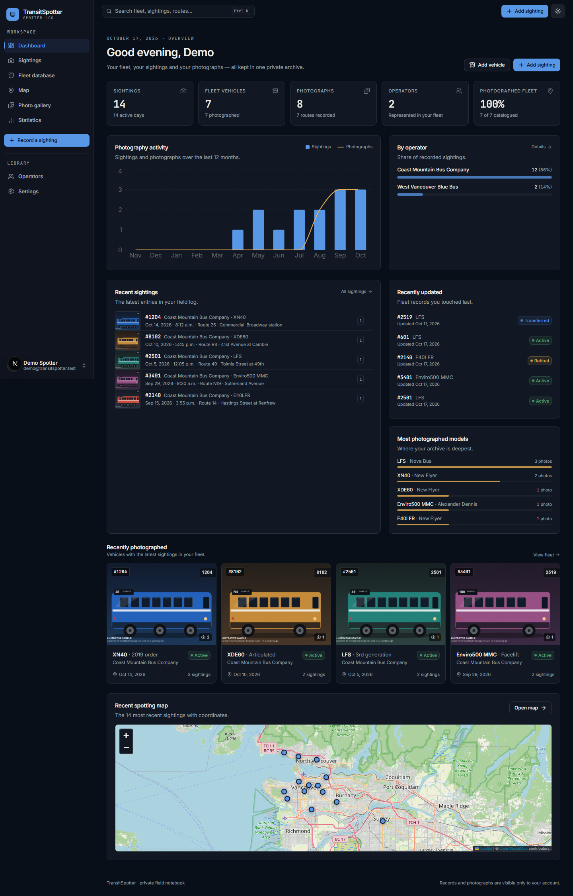 |
| 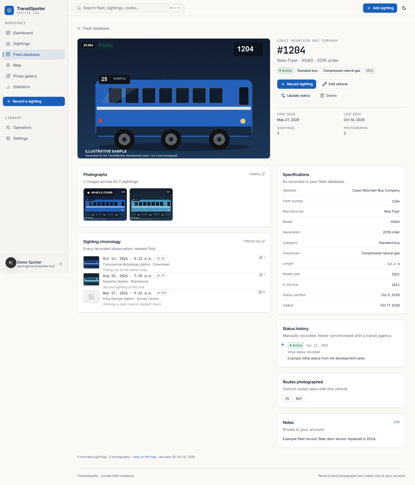 | 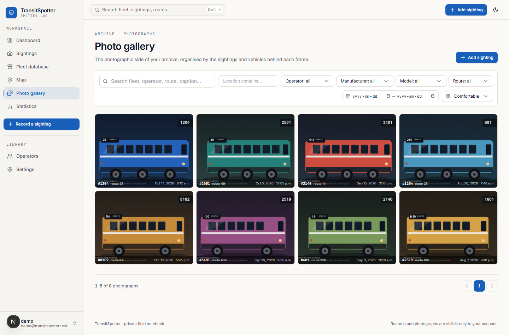 |
| 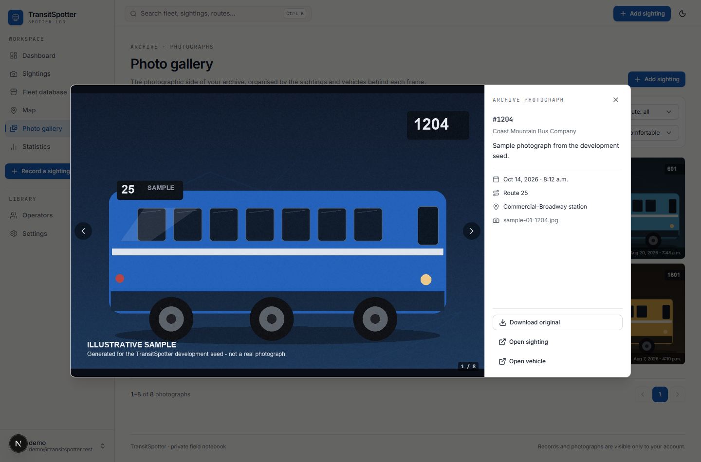 | 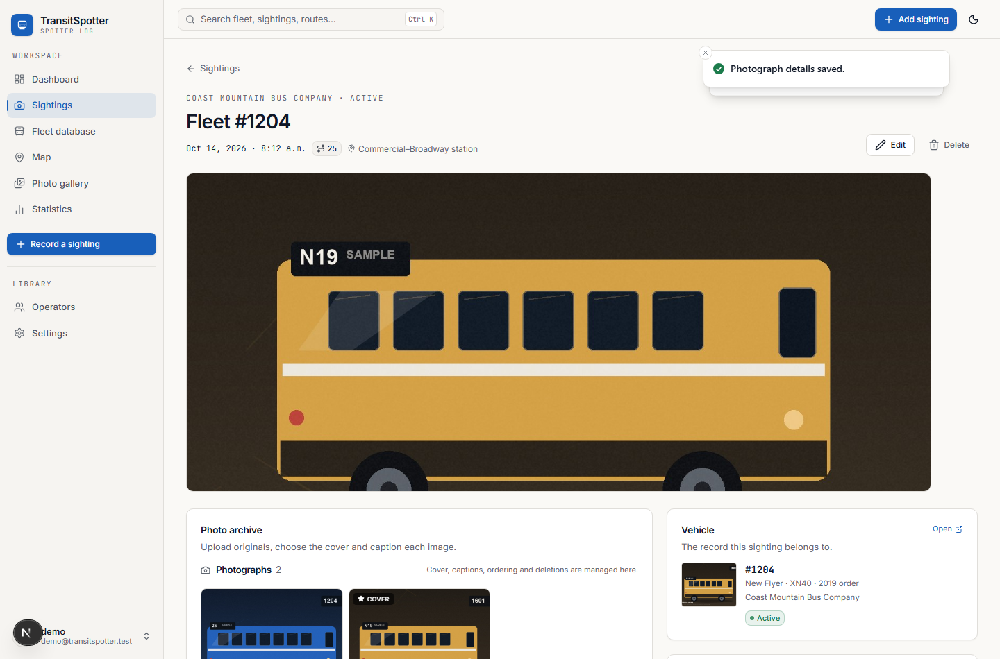 |
| 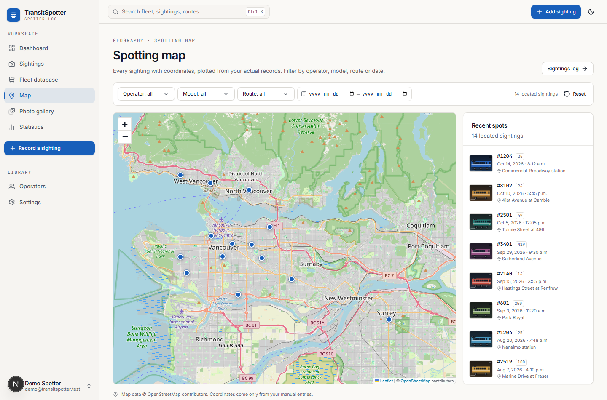 | 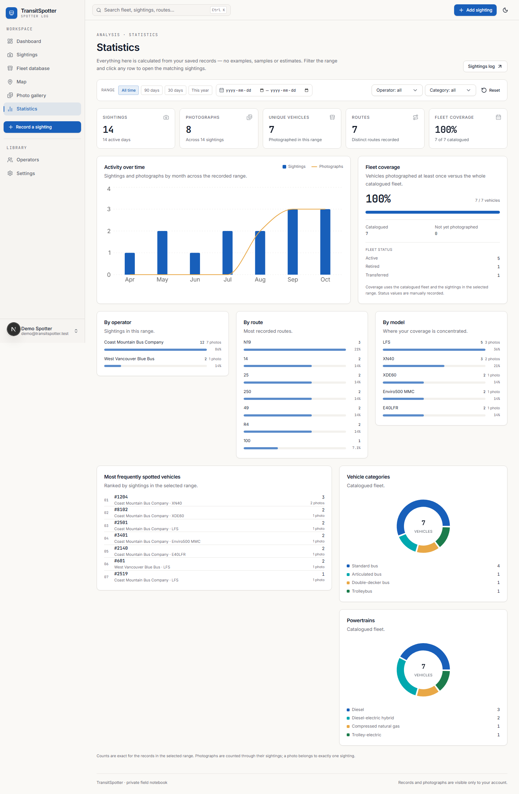 |
| 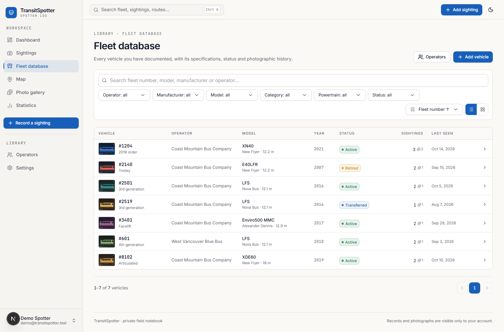 | 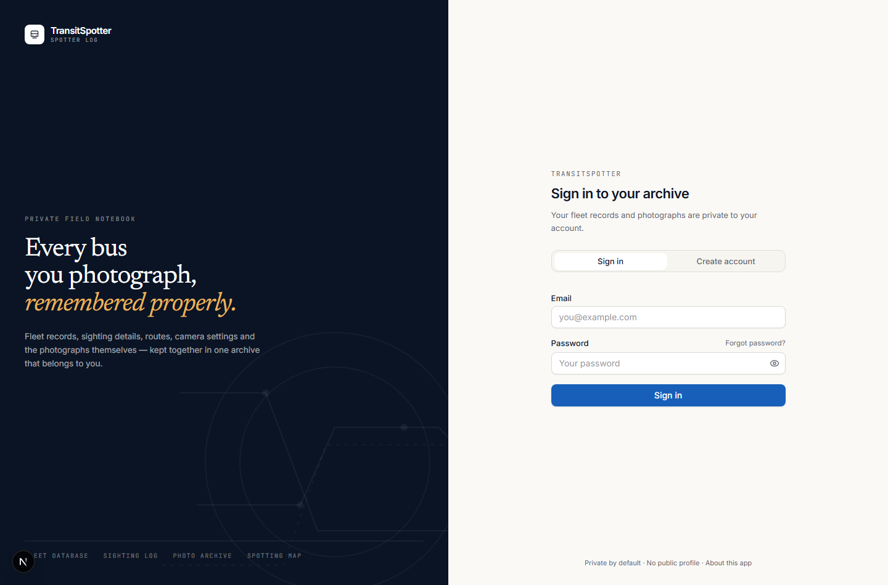 |
| 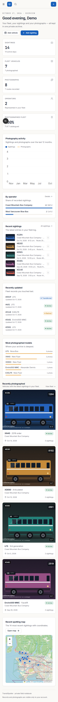 | 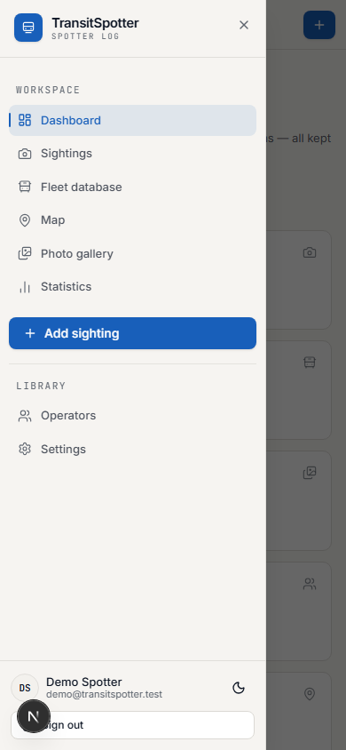 |

---

## Attributions

- Map tiles and data © [OpenStreetMap contributors](https://www.openstreetmap.org/copyright), served through the public OSM tile service and displayed with attribution.
- Leaflet, React Leaflet, Recharts, Radix UI, Lucide, Sonner, PapaParse and Archiver are used under their respective open-source licences.
- Sample seed images are generated illustrations created by `scripts/generate-seed-images.py`; they are not photographs of real vehicles and are clearly labelled as samples.
- TransitSpotter is not affiliated with TransLink, Coast Mountain Bus Company, West Vancouver Blue Bus, or any other transit agency.
